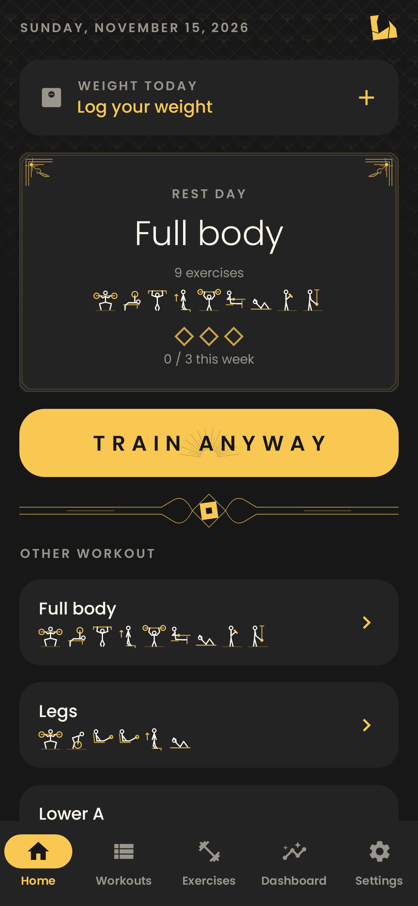
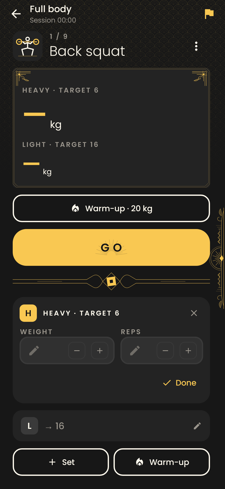
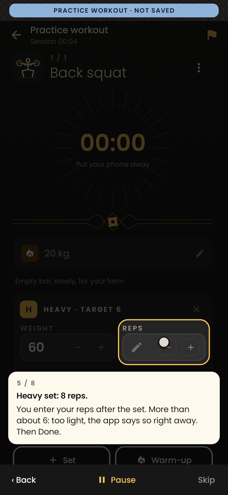
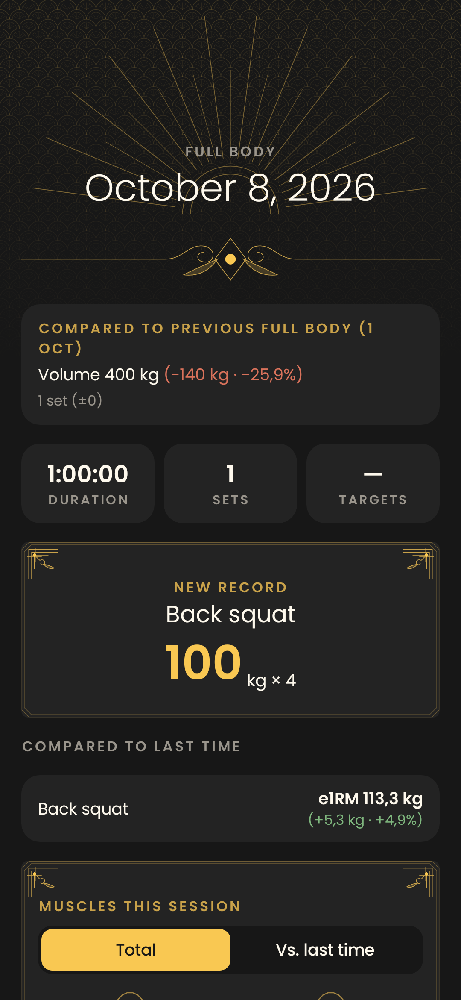

# GYM-8020

Android app for strength training with a fixed method: per exercise a **heavy** set (aim for ~6 reps) and a **light** set (aim for ~16 reps), straight after each other and both to failure. After each exercise you set the **target for next time**, so you keep pushing yourself.

Made by [Fabian Langer](https://fabianlanger.nl), with a nod to [Isatis Business Solutions](https://i-b-s.nl) in the logo.

> **Version 1.0.** The first public version. Make an export now and then (Settings → Export all data); what changed per version is in [CHANGELOG.md](CHANGELOG.md).

  
  
  
  

## Features

- **Training**: optional warm-up with your own default, **GO** → 3-2-1 → exercise timer, swipe to the next exercise; add, skip or move exercises on the fly
- **Target for next time** per set: the app gives advice (too light / good / too heavy), but your target is yours. Change one set and the others keep following your performance
- **Plate stacking**: the heavy weight is the light weight plus extra plates on the outside, so between the heavy and the light set you only take plates off
- **Material**: bars, plates, pin stacks, cables and dumbbells; the app only suggests weights you can actually load
- **Bodyweight exercises** with extra weight or assistance, counted as effective weight (your body weight plus or minus the load)
- **Body weight**: several measurements a day; the one that counts for a training is the last one before you start
- **Workouts and programs** (Full body, Push/Pull/Legs, Upper/Lower) with day recognition on the home screen
- **Library** of ~55 exercises with muscles and movement icons, plus your own exercises
- **Summary** after each training: comparison per exercise and per workout, records, and a muscle map
- **Dashboard**: progress per exercise, muscle and muscle group, balance, frequency, durations, records, body weight trend
- **Log**: all finished trainings; correct sets, exercises, date and duration afterwards
- **Reminders** (optional, local): training day, week target, training still open, body weight
- **Backup**: Android backup via your Google account, an automatic backup after each training to a folder you choose, and export/import of all data as one file
- **Practice workout that plays itself** for new users: in about a minute the app taps and types through one short exercise while a balloon explains each part; you only watch, nothing is saved. Start it again any time from Settings
- Introduction for new users, an in-app explanation of the method; English and Dutch

## Installing

1. Download the newest version from **[Releases](https://github.com/Fabianlanger/GYM-8020/releases/latest)** (`gym-8020-v1.0.0.apk`). Want the newest work in progress? The dev build is always at https://github.com/Fabianlanger/GYM-8020/releases/download/dev/gym-8020.apk (same key, installs over a version).
2. On your phone, allow installing apps from unknown sources for your browser or file manager.
3. Open the APK. Updates install over the previous version and keep your data.

> **Installing an APK from the internet skips the checks of the Play Store.** Only do this if you trust the source. The code is open: you can read exactly what the app does.

> **All data is stored only on your phone.** No account, no server. Uninstalling the app deletes your data, unless you have made an export (Settings → Export all data).

## Development

- Kotlin, Jetpack Compose (Material 3), Room, DataStore. Min. Android 8.0.
- `core/` holds the pure-Kotlin logic (targets, advice, effective weight, plate stacking, comparisons, backup format) with unit tests: `./gradlew :core:test` (add `-PcoreOnly` to build without the Android SDK).
- `app/` is the Android app: `./gradlew :app:assembleDebug`. CI builds every push and publishes the dev build.
- Builds from CI are signed with the project's own key, kept in GitHub Secrets only. A local build without that key falls back to the committed debug key (`app/debug.keystore`), which cannot update an installed release build. See [`docs/RELEASE.md`](docs/RELEASE.md).
- How we work: [`GLOSSARY.md`](GLOSSARY.md) (shared language), [`docs/adr/`](docs/adr) (decisions), GitHub Issues (work and decisions), [`docs/TESTING.md`](docs/TESTING.md) (test strategy).

Docs: [`docs/DESIGN.md`](docs/DESIGN.md) (visual style), [`docs/methode.md`](docs/methode.md) (the method, in Dutch; also in the app under Settings → About the method), [`docs/RELEASE.md`](docs/RELEASE.md) (releases and signing). [`docs/SPEC.md`](docs/SPEC.md) is the original specification (archive).

## License

MIT, see [LICENSE](LICENSE). Poppins font: SIL Open Font License ([assets/fonts/Poppins-OFL.txt](assets/fonts/Poppins-OFL.txt)).
